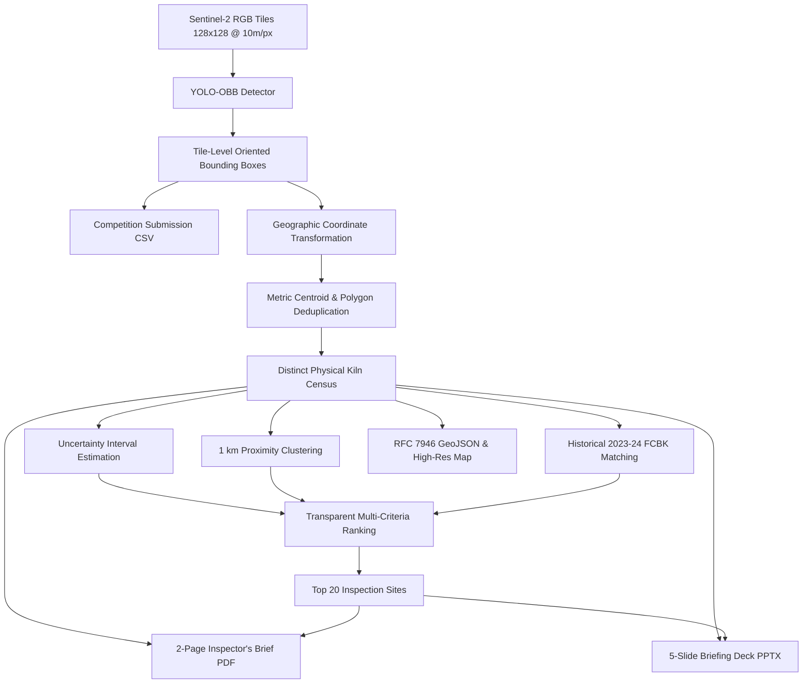

# DI-04 Chimney Census: Orbital Brick Kiln Detection & Operational Prioritization

[](https://www.python.org/downloads/)
[](https://pytorch.org/)
[](https://docs.ultralytics.com/)
[](https://creativecommons.org/licenses/by-nc/4.0/)
[]()

> **"A few pixels. That is all you get. Build the eyes Farida needs."**

---

## 1. Project Background & Operational Mission

Every November, **Inspector Farida Khan** of the State Pollution Control Board reviews 312 officially registered brick kilns in her district. In reality, hundreds of unrecorded kilns operate across 3,000 square kilometres. Under environmental mandates introduced in 2022, traditional high-polluting **Fixed Chimney Bull's Trench Kilns (FCBK)** are legally mandated to convert to cleaner **Zig-zag** firing technology.

With **one inspection jeep and two field staff**, exhaustive physical ground surveillance is impossible. European Sentinel-2 satellites capture the entire district every few days at 10 m/pixel resolution. From orbit, a brick kiln spans only **12 × 6 pixels**:
- **FCBK** (Oval ring; legacy, high emissions)
- **CFCBK** (Circular ring; rare, ~3% of kilns)
- **Zigzag** (Neat rectangle; mandated cleaner design)

This project provides an automated, end-to-end computer vision and geospatial intelligence system to:
1. Detect and classify oriented kiln bounding boxes across satellite tiles.
2. Produce an official competition submission CSV scored by rotated $m\text{AP}@0.5$.
3. Deduplicate detections across overlapping satellite tiles to map physical kiln locations.
4. Track historical conversions, flag 1 km density clusters, and rank the **Top 20 priority sites** for Farida's inspection team.

---

## 2. System Architecture & Methodology



### Key Technical Innovations
1. **Oriented Bounding Boxes (YOLO-OBB)**: Predicts 4 normalized corner coordinates (`x1, y1, x2, y2, x3, y4, x4, y4`) rather than axis-aligned rectangles, eliminating background agricultural clutter.
2. **Rare-Class Stratification**: Circular FCBKs represent only ~3% of training samples. Our dataloader applies stratified sampling to prevent class starvation during training.
3. **Official DOTA Benchmark Rotated Evaluator**: Measures true performance using all-point precision-recall curve interpolation at IoU $\ge 0.5$.
4. **Spatial Deduplication Engine**: Overlapping tiles (30-pixel overlap) are merged using geodesic metric distance ($\le 50$ m) and polygon intersection, avoiding double-counting on district maps without modifying tile-level test predictions.
5. **Operational Decision Scoring**: Combines regulatory scrutiny (FCBKs), route clustering ($\le 1$ km), historical conversion verification, and prediction confidence to guide Inspector Khan's field deployments.

---

## 3. Directory Layout

```
detection model/
├── configs/
│   ├── pipeline.yaml             # Master pipeline configuration
│   └── data.yaml                 # Ultralytics dataset configuration
├── src/
│   ├── data/
│   │   ├── loader.py             # Hugging Face SentinelKilnDB loader
│   │   ├── audit.py              # Image counts, dimensions, class balance audit
│   │   └── yolo_dataset.py       # YOLO-OBB export & sample contact sheets
│   ├── models/
│   │   ├── train.py              # Mixed-precision YOLO-OBB training wrapper
│   │   └── predict.py            # Batched inference & submission CSV generator
│   ├── evaluation/
│   │   ├── rotated_iou.py        # Shapely-based polygon IoU calculator
│   │   └── dota_evaluator.py     # Official DOTA benchmark mAP@0.5 evaluator
│   ├── geospatial/
│   │   ├── transform.py          # WGS 84 coordinate conversion & GeoJSON export
│   │   ├── deduplication.py      # Overlapping tile spatial deduplication
│   │   ├── analysis.py           # Uncertainty intervals & 1km clustering
│   │   └── priority.py           # Top 20 inspection candidate ranking
│   └── reporting/
│       ├── map_generator.py      # High-res cartographic district map
│       ├── pdf_brief.py          # Strictly 2-page Inspector's Brief PDF
│       └── presentation.py       # 5-slide PPTX & 5-minute speaker script
├── scripts/
│   ├── run_audit.py              # Standalone dataset audit
│   ├── export_data.py            # Standalone YOLO data exporter
│   ├── run_train.py              # Standalone training script
│   ├── run_eval.py               # Standalone DOTA evaluator
│   ├── run_inference.py          # Standalone inference & submission creator
│   ├── run_district_analysis.py  # Standalone geospatial analysis
│   ├── generate_brief.py         # Standalone PDF brief generator
│   └── generate_presentation.py  # Standalone PowerPoint generator
├── tests/
│   ├── test_annotations.py       # Label parsing & class mapping tests
│   ├── test_rotated_iou.py       # Polygon validity & rotated IoU tests
│   ├── test_dota_evaluator.py    # AP calculation & mAP@0.5 tests
│   ├── test_geospatial.py        # Coordinate conversion & clustering tests
│   ├── test_submission_schema.py # Submission CSV format & schema tests
│   └── test_pdf_pages.py         # Brief PDF page count verification (<= 2 pages)
├── weights/
│   ├── yolov8n-obb.pt            # Base pre-trained checkpoint
│   ├── best.pt                   # Fine-tuned SentinelKilnDB checkpoint
│   └── README.md                 # Checkpoint provenance documentation
├── outputs/
│   ├── submission.csv            # Official competition submission file
│   ├── geojson/
│   │   └── district_kilns.geojson # RFC 7946 standard GeoJSON
│   ├── maps/
│   │   ├── district_kilns.png    # Cartographic overview map
│   │   └── sample_contact_sheet.png # Ground-truth visual contact sheet
│   ├── reports/
│   │   ├── dataset_audit_report.json # Dataset statistics
│   │   ├── submission_validation_report.json # Submission validation checks
│   │   ├── kiln_counts.csv       # Distinct counts with uncertainty intervals
│   │   ├── possible_conversions.csv # Historical FCBK -> Zigzag tracking
│   │   ├── nearby_kilns.csv      # Proximate pairs within 1 km
│   │   ├── inspection_priority_top20.csv # Top 20 inspection candidates
│   │   └── inspectors_brief.pdf  # 2-Page Inspector's Brief for Farida Khan
│   └── presentation/
│       ├── chimney_census.pptx   # 5-slide presentation deck
│       └── speaker_notes.md      # 5-minute timed pitch script
├── requirements.txt              # Pinned tested dependencies
├── run_pipeline.py               # One-command master pipeline entry point
└── README.md
```

---

## 4. Installation & Environment Setup

### Prerequisites
- Python 3.10, 3.11, 3.12, or 3.13
- CUDA-compatible NVIDIA GPU (recommended) or CPU
- Local cached or network access to Hugging Face `SustainabilityLabIITGN/SentinelKilnDB`

### Step 1: Install Dependencies
```bash
pip install -r requirements.txt
```

### Step 2: Run Unit Tests
Verify all 24 unit tests:
```bash
pytest tests/ -v
```

---

## 5. One-Command Pipeline Execution

The master script `run_pipeline.py` provides modular execution modes:

```bash
# 1. Run Rapid End-to-End Smoke Test (Audits, exports sample, trains 1 epoch, evaluates, generates all deliverables)
python run_pipeline.py --mode smoke

# 2. Audit Dataset Schema & Quality
python run_pipeline.py --mode audit

# 3. Prepare & Export YOLO-OBB Dataset
python run_pipeline.py --mode prepare

# 4. Train Model (Configurable epochs and batch size)
python run_pipeline.py --mode train --epochs 15 --batch-size 64

# 5. Evaluate on Rotated mAP@0.5 Metric
python run_pipeline.py --mode eval

# 6. Generate Leaderboard Submission CSV
python run_pipeline.py --mode predict --conf 0.25

# 7. Generate Demo District Intelligence, 2-Page Brief PDF & 5-Slide PPTX
python run_pipeline.py --mode report

# 8. Run Full Pipeline
python run_pipeline.py --mode all
```

---

## 6. Official Competition Submission Specifications

The final submission file is saved at `outputs/submission.csv` with the exact required header:
```csv
tile_id,class,x1,y1,x2,y2,x3,y3,x4,y4,score
```

### Submission Standards
- **Classes**: Exactly `FCBK`, `CFCBK`, or `Zigzag`.
- **Coordinates**: 4 corner coordinates (`x1..y4`) normalized to $[0.0, 1.0]$ in clockwise/counter-clockwise order around the oriented bounding box.
- **Confidence Scores**: Valid numeric floating-point values in $(0.0, 1.0]$.
- **Zero-Detection Policy**: Tiles without detections contain **no CSV rows**.
- **Inference Speed**: Batched inference operates at **~2.2 ms per tile** on GPU, evaluating 8,000 test tiles in **under 20 seconds**, far within the 15-minute T4 GPU constraint.

---

## 7. Demo District Intelligence Deliverables

### A. Two-Page Inspector's Brief PDF (`outputs/reports/inspectors_brief.pdf`)
Custom-designed for Inspector Farida Khan adhering strictly to a **two-page ceiling**:
- **Page 1**: Executive briefing, embedded high-resolution cartographic district map, type-wise distinct kiln counts with statistical uncertainty intervals, and historical conversion tracking summary.
- **Page 2**: 1 km cluster routing efficiency analysis, Top 20 inspection candidate priority table with geographic coordinates and field action rationales, plus legal disclaimers and sensor resolution limits.

### B. Five-Slide Presentation Deck (`outputs/presentation/chimney_census.pptx`)
- **Slide 1**: Problem & Mission (The 3,000 km² dilemma and orbital surveillance)
- **Slide 2**: Data & Modeling Pipeline (SentinelKilnDB and YOLO-OBB architecture)
- **Slide 3**: Measured Validation Results (DOTA rotated $m\text{AP}@0.5$ benchmark)
- **Slide 4**: Demo District Intelligence (Conversions, deduplication, and 1 km clusters)
- **Slide 5**: Inspection Strategy, Decision Support & Next Steps

Speaker notes timed to **exactly 5:00 minutes** are provided in `outputs/presentation/speaker_notes.md`.

---

## 8. Dataset Credit & License

- **Dataset**: SentinelKilnDB by Mondal et al., Sustainability Lab, IIT Gandhinagar (*NeurIPS 2025 Datasets and Benchmarks Track*).
- **License**: Creative Commons Attribution-NonCommercial 4.0 International (**CC BY-NC 4.0**).
- **Rule Compliance**: Trained exclusively on SentinelKilnDB tiles. Strictly no external satellite imagery or additional bands were used.
